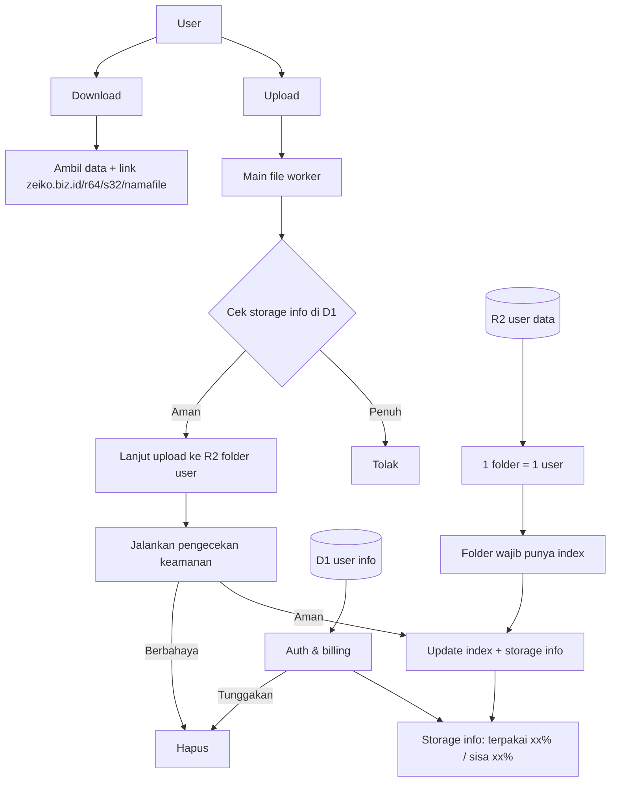

# Zeiko Cloud Storage — Spesifikasi Build untuk Claude Code

> **Untuk Claude Code:** kamu adalah lead engineer full-stack proyek ini. Dokumen ini adalah spesifikasi lengkap Zeiko Cloud Storage. Baca sampai habis sebelum menulis kode apa pun, lalu ikuti Bagian 0.

---

## 0. Cara kerja

### 0.1 Urutan mulai
1. Baca dokumen ini sampai habis.
2. Cek dokumentasi Cloudflare terbaru untuk setiap limit dan API yang dipakai di sini (Workers, R2, D1, Queues, KV, Images, Media Transformations, Containers, Email Service, Turnstile, Rate Limiting, Analytics Engine, Cron Triggers). Pakai MCP dokumentasi Cloudflare kalau tersedia. Kalau ada yang berbeda dari dokumen ini, ikuti dokumentasi terbaru dan catat di `DECISIONS.md`.
3. Buat di root repo:
   - `docs/SPEC.md`: salinan dokumen ini, sumber kebenaran.
   - `PLAN.md`: rencana teknis per fase (modul, urutan, risiko).
   - `PROGRESS.md`: checklist per fase. Centang tiap item yang selesai supaya pekerjaan bisa dilanjutkan di sesi lain.
   - `DECISIONS.md`: keputusan arsitektur (format ADR singkat).
   - `CLAUDE.md`: aturan proyek (perintah dev/test/deploy, konvensi, larangan).
4. Tampilkan ringkasan `PLAN.md` dan pertanyaan Bagian 16 yang belum terjawab, **sekali saja**. Sambil menunggu jawaban, lanjut kerja dengan default Bagian 16.
5. Kerjakan per fase (Bagian 15). Tiap fase: kode + migrasi + test + docs → semua test hijau → commit (Conventional Commits) → ringkasan 3–5 baris → lanjut fase berikutnya.
6. Berhenti dan tanya **hanya** kalau: butuh secret/kredensial, butuh keputusan bisnis yang tidak ada di Bagian 16, atau akan melakukan aksi destruktif/produksi (hapus bucket/DB/data remote, deploy production, kirim pesan ke nomor/email sungguhan).

### 0.2 Aturan umum
- TypeScript strict, ESLint + Prettier. Tidak ada `any` tanpa komentar alasan.
- Teks UI dalam Bahasa Indonesia yang santai, sopan, dan jelas. Kode dan komentar boleh English. String UI dikumpulkan di satu tempat (siap i18n).
- Waktu disimpan UTC. Tagihan, iklan, dan tampilan memakai Asia/Jakarta (WIB). Ingat: Cron Cloudflare memakai UTC.
- Uang = integer Rupiah. Ukuran = integer byte. "GB" di UI dan di kuota = 2^30 byte (sama dengan tampilan Windows/Android, jadi user tidak merasa kuotanya "kurang").
- Semua angka bisnis (harga, kuota, limit, masa tenggang, slot iklan, rate limit) disimpan di DB/config dan bisa diubah dari admin. Tidak ada yang di-hardcode.
- Setiap layanan pihak ketiga lewat adapter yang punya implementasi `mock`, sehingga seluruh aplikasi bisa jalan lokal tanpa kredensial apa pun.
- Jangan commit secret. Pakai `wrangler secret` dan `.dev.vars` (masuk `.gitignore`).
- Jangan menambah fitur di luar dokumen ini tanpa mencatatnya di `DECISIONS.md`.

---

## 1. Ringkasan produk

**Zeiko Cloud Storage** adalah penyimpanan awan murah untuk pasar Indonesia, rasanya seperti Google Drive/Terabox.

Enam fitur utama:
1. Upload dan download lewat website Zeiko (bukan akses S3 langsung oleh klien), **tanpa pembatasan kecepatan** dari sisi kami.
2. Link share yang sekali klik **langsung mengunduh** file, bisa dibagikan via QR, WhatsApp, Telegram, email, dll. dengan pesan custom.
3. Download banyak file sekaligus sebagai arsip **ZIP atau TAR.ZST** dengan pilihan kompresi.
4. **File explorer** ala Google Drive.
5. **Paket keluarga**: tiap file/folder bisa pribadi atau terlihat oleh keluarga.
6. **Iklan lokal non-intrusif**: slot dibuka tiap hari, UMKM/mahasiswa/dll. bisa memasang iklan murah yang ditargetkan per daerah.

Ditambah dari spreadsheet harga: **kompres media** (gambar dan video) dari kuota paket atau dibeli terpisah, serta **add-on storage**. Tanpa paket gratis. Paket termurah Rp1.000/bulan.

Prinsip: **murah, cepat, privat, iklan sopan.** Tidak ada waktu tunggu, captcha, atau iklan yang menghalangi download.

Sumber harga: spreadsheet "Zeiko cloud storage" (https://docs.google.com/spreadsheets/d/1HFK393XDOw6t_T3__5vUz02VY9LZnNOemEJOPmRxWPQ). Isinya sudah disalin ke Lampiran A dan B sebagai data seed.

---

## 2. Arsitektur & stack

| Lapisan | Pilihan |
|---|---|
| Runtime | Cloudflare Workers (TypeScript). Satu Worker utama dengan handler `fetch`, `queue`, `scheduled`. Frontend dilayani lewat Workers Static Assets. Boleh dipecah nanti via service bindings. |
| API | Hono + Zod |
| Frontend | React + Vite (`@cloudflare/vite-plugin`), TanStack Router + Query, Tailwind + shadcn/ui, TanStack Virtual, PWA |
| Database | **Target (ADR-064, pemilik 2026-10-26): Drive tidak memakai D1.** Pohon file = satu index per user (`u/{userId}/index.txt`) dan per keluarga (`f/{familyId}/index.txt`) di R2; akun, paket, dan pembayaran di relay; D1 hanya untuk Zeiko S3. *Sekarang (sebelum migrasi fase R):* D1 + Drizzle, FTS5 untuk nama. |
| Objek | R2 bucket privat (public access dan r2.dev mati), location hint APAC |
| Async | Queues: `scan`, `archive`, `compress`, `notify`, `cleanup` |
| Terjadwal | Cron Triggers (13.4) |
| Cache/config | KV (config dan kandidat iklan, TTL pendek) + Cache API |
| Metrik | Workers Analytics Engine |
| Anti-abuse | Turnstile, Rate Limiting binding |
| Media | Images binding (gambar), Media binding/Media Transformations (video pendek saja), Containers: `scanner` (ClamAV + hashing), `media` (ffmpeg), `archiver` (tar.zst, zip besar) |
| Auth | Better Auth di D1: Google OAuth, email OTP/magic link, passkey. **Tanpa password.** Admin wajib passkey/TOTP. Kalau Better Auth bermasalah di Workers, implementasi sendiri (sesi di D1 + library `arctic` untuk OAuth) dan catat di `DECISIONS.md`. |
| Email | Cloudflare Email Service (binding `EMAIL`; kirim ke alamat sembarang butuh Workers Paid dan domain yang sudah di-onboard) lewat adapter `EmailSender` |
| Pembayaran | Adapter `PaymentProvider` (12.3) |
| Test | Vitest + `@cloudflare/vitest-pool-workers`, Playwright (E2E), k6 (beban download) |
| CI/CD | GitHub Actions: lint, typecheck, test → `wrangler deploy` ke `staging`. Production hanya manual. |

Lingkungan: `dev` (lokal, semua adapter mock, data seed demo), `staging`, `production`, dengan resource terpisah per lingkungan.

Struktur repo (usulan):
```
zeiko/
├─ src/
│  ├─ worker/     index.ts, routes/, services/, adapters/, queues/, cron/, middleware/
│  ├─ web/        React app
│  └─ shared/     tipe, skema Zod, konstanta
├─ migrations/    SQL D1
├─ containers/    scanner/, media/, archiver/
├─ tests/         unit/, integration/, e2e/
├─ docs/          SPEC.md, runbook, draf kebijakan, LAUNCH-CHECKLIST.md
└─ wrangler.jsonc
```

Domain:
- `APP_ORIGIN` (default `https://zeiko.biz.id`, sesuai diagram): app, API, dan link share.
- `USERCONTENT_ORIGIN` (default `https://uc.zeiko.biz.id`): **hanya** untuk pratinjau inline konten user lewat URL bertanda tangan. Worker yang sama melayani host ini, tapi semua route selain pratinjau → 404. Detail keamanan di 14.4.

---

## 3. Alur dari diagram (wajib diikuti)

Diagram drawio milik pemilik proyek, diterjemahkan:



Pemetaan node → implementasi:

| Node di diagram | Implementasi |
|---|---|
| Main file worker | Worker utama, route `/api/uploads/*` dan `/api/files/*` |
| Check D1 storage info → Penuh → Tolak | Reservasi kuota atomik saat upload dimulai (5.2). Kalau tidak cukup → HTTP 413 `QUOTA_FULL` + pesan ramah + tombol upgrade/add-on |
| Lanjut upload ke R2 folder user | Multipart upload ke `u/{uploaderId}/{blobId}` |
| Jika sudah, jalankan check | Setelah upload complete → pesan ke Queue `scan` |
| virustotal | **Diganti** rantai adapter `Scanner` (14.2). Isi file user TIDAK BOLEH dikirim ke VirusTotal. **Diubah pemilik 2026-10-25 (ADR-046):** VirusTotal dipakai, lihat 14.2. |
| Berbahaya → Hapus | Hapus objek R2, status `infected`, reservasi kuota dilepas, notifikasi ke user, hash masuk blocklist |
| Aman → Update index.txt dan storage info | Entri file di index user jadi `ready`, reservasi berubah jadi pemakaian (total di header index). *Sekarang:* blob `clean`, node `ready` di D1. |
| 1 folder 1 user | Semua blob user di prefix `u/{uploaderId}/` |
| Inside folder must have index.txt | **Sesuai diagram (ADR-064, menggantikan ADR-002):** satu index per user di `u/{userId}/index.txt` (keluarga: `f/{familyId}/index.txt`) berisi nama file dan struktur folder (keluarga: juga kepemilikan). Index adalah sumber kebenaran pohon file dan hal pertama yang ditarik klien. Ditulis dengan syarat etag R2 (bentrok → baca ulang, ulangi), jadi dua upload bersamaan tidak saling menimpa. Format: JSON tabel ringkas ter-gzip (ADR-064). *Sekarang:* masih tabel D1 sampai fase R selesai. |
| Ambil data dan link download | Link share (6.1) |
| Auth dan billing → Hapus | Siklus tunggakan bertahap (12.5). Hapus permanen hanya setelah masa tenggang dan notifikasi berlapis. |

**Key objek opaque.** Nama file dan struktur folder hanya hidup di index (ADR-064; *sekarang* di D1). Key R2 selalu `u/{uploaderId}/{blobId}`, jadi ganti nama, pindah folder, atau pindah Pribadi ⇄ Keluarga cukup update index, tanpa copy di R2. Penghapusan selalu digerakkan oleh index (refcount blob), **bukan** "hapus seluruh prefix".

---

## 4. Model data D1 (draf)

> **Keadaan sekarang, bukan target.** Sejak ADR-064 (pemilik, 2026-10-26) Drive tidak boleh memakai D1: pohon file pindah
> ke index R2 per user/keluarga, akun/paket/pembayaran ke relay, sisanya sesuai tabel di ADR-064. Model di bawah tetap
> menggambarkan kode sampai fase R di `docs/ROADMAP.md` selesai. Jangan menambah tabel atau kolom Drive di sini.

Boleh disempurnakan. Perubahan besar dicatat di `DECISIONS.md`.

```
users               id, email, name, avatar_url, ad_city_code (nullable), role (tidak dipakai sejak ADR-057),
                    status(active|suspended|deleted), created_at
(tabel auth)        ikuti skema Better Auth: session, account, verification, passkey, twoFactor
app_config          key, value_json, updated_by, updated_at                     ← seed Lampiran B
plans               code, name, kind(personal|family), price_idr, storage_bytes, compress_quota,
                    max_members, max_file_bytes, show_ads, active, sort        ← seed Lampiran A
addons              code, name, price_idr, storage_bytes, active
compress_packs      code, name, price_idr, credits, ttl_days, active
storage_pools       id, owner_type(user|family), owner_id, limit_bytes, used_bytes, reserved_bytes,
                    updated_at                                                  ← "storage info" di diagram
subscriptions       id, pool_id, payer_user_id, plan_code,
                    status(active|grace|readonly|suspended|deleted|cancelled),
                    period_start, period_end, auto_renew, cancel_at_period_end, created_at
subscription_addons id, subscription_id, addon_code, qty, starts_at, ends_at
blobs               id, r2_key, size, sha256, crc32, sniffed_mime, uploader_id, refcount,
                    scan_status(pending|clean|infected|skipped|error), scan_detail, thumb_key, created_at
nodes               id, pool_id, space(personal|family), family_id, owner_id, created_by, parent_id,
                    kind(file|folder), name, name_key, blob_id, size, mime, family_can_edit,
                    status(uploading|scanning|ready|rejected), trashed_at, trashed_by, purge_at,
                    created_at, updated_at, version
nodes_fts           FTS5(name), disinkronkan dengan nodes
node_stars          user_id, node_id
node_recent         user_id, node_id, accessed_at                (simpan maks 200 per user)
uploads             id, user_id, node_id, blob_id, r2_key, r2_upload_id, size, part_size, total_parts,
                    reserved_bytes, status(active|completed|aborted|expired), expires_at, created_at
upload_parts        upload_id, part_number, etag, size           PK(upload_id, part_number)
shares              id (= r64), created_by, kind(file|bundle|folder), title, expires_at, max_downloads,
                    download_count, password_hash, revoked_at, last_download_at, created_at
share_items         share_id, node_id
share_sends         id, share_id, user_id, channel(qr|whatsapp|telegram|email|copy|webshare),
                    mode(deeplink|bot|api), recipient_masked, recipient_hash, message, status,
                    provider_ref, created_at
contacts            id, user_id, display_name, channel, value_encrypted, created_at   ← buku kontak opsional
telegram_links      user_id, tg_user_id, chat_id, username_lower, allow_receive, linked_at
families            id, owner_id, pool_id, name, created_at
family_members      family_id, user_id, role(owner|member), cap_bytes (nullable), joined_at
family_invites      id, family_id, token_hash, invited_by, channel, expires_at, accepted_by, accepted_at
archive_jobs        id, user_id, node_ids_json, format(zip_store|zip_deflate|tar_zst), level, status,
                    total_bytes, out_key, expires_at, error, created_at
compress_jobs       id, user_id, source_node_id, kind(image|video), engine(images|media|ffmpeg),
                    options_json, status, out_node_id, credits_used, saved_bytes, error, created_at
credit_ledger       id, user_id, delta, source(plan|pack|refund|usage|adjust), ref, expires_at, created_at
wallets             user_id, balance_idr
wallet_ledger       id, user_id, delta_idr, balance_after, reason, ref, created_at   ← append-only
payments            id, user_id, provider, provider_ref UNIQUE, method, amount_idr, fee_idr, status,
                    purpose(topup|direct), raw_json, created_at, paid_at
invoices            id, number UNIQUE, user_id, lines_json, subtotal_idr, tax_idr, total_idr, status, issued_at
ad_areas            code (kode wilayah Kemendagri), name, level(province|regency), parent_code, tier,
                    cf_aliases_json
ad_prices           area_level, tier, placement, price_per_day_idr, active
ad_inventory        date, area_code, placement, total_slots, booked_slots   PK(date, area_code, placement)
advertisers         user_id, business_name, kind(umkm|mahasiswa|lainnya), student_verified, phone, created_at
ad_creatives        id, advertiser_id, title, body, image_key, cta_type, cta_value, category,
                    status(draft|pending|approved|rejected|suspended), reject_reason, reviewed_by, reviewed_at
ad_bookings         id, creative_id, area_code, placement, date, price_idr,
                    status(held|paid|live|completed|refunded|cancelled), hold_expires_at, impressions, clicks
abuse_reports       id, target_type(share|node|blob|ad|user), target_id, category, priority(urgent|normal),
                    reporter_contact, details, status, sla_due_at, resolved_by, action, created_at
blocked_hashes      sha256, reason, created_at
legal_holds         blob_id, reason, created_by, created_at
notifications       id, user_id, type, payload_json, read_at, created_at
notification_prefs  user_id, type, channel(inapp|email|telegram), enabled
audit_logs          id, actor_id, action, target_type, target_id, ip_hash, meta_json, created_at
```

Invarian yang wajib dijaga (dan dites):
- **Reservasi kuota atomik** dengan satu UPDATE kondisional:
  `UPDATE storage_pools SET reserved_bytes = reserved_bytes + :n WHERE id = :pool AND used_bytes + reserved_bytes + :n <= limit_bytes`. Kalau `meta.changes = 0`, berarti penuh. Saat scan `clean`, reserved pindah ke used dalam satu `db.batch`. Saat gagal/abort/kedaluwarsa, reserved dilepas.
- **Setiap ruang punya node folder root sendiri** (jangan pakai `parent_id` NULL), supaya `UNIQUE(parent_id, name_key) WHERE trashed_at IS NULL` berlaku sampai ke root. `name_key` = nama dinormalisasi NFC + lowercase (aman saat diekstrak di Windows).
- Pemakaian = ukuran logis node yang belum dihapus permanen. File di Sampah tetap dihitung (config).
- Satu blob boleh dipakai beberapa node **dalam pool yang sama** ("Buat salinan" = refcount+1, tanpa copy fisik; kuota tetap dihitung per node). Dedup lintas pool/user **dilarang**, karena bisa membocorkan info "file ini sudah ada di sistem".
- Objek R2 dihapus hanya kalau refcount = 0 dan tidak ada legal hold.
- Cron rekonsiliasi harian menghitung ulang `used_bytes` dari `nodes` dan mengirim alert kalau ada selisih.
- ID internal ULID/UUIDv7, tidak berurutan dan tidak mudah ditebak.
- Cek batas ukuran database D1 di docs. Rancang query dan ID supaya bisa di-shard nanti.

---

## 5. Fitur 1: Upload & download tanpa batas kecepatan

### 5.1 Prinsip
- Semua upload/download lewat Worker kita memakai binding R2. Klien **tidak pernah** menerima kredensial S3 maupun presigned URL R2.
- Tidak ada throttling buatan, antrean, waktu tunggu, atau captcha sebelum download. Kecepatan hanya dibatasi koneksi pengguna dan jaringan Cloudflare.
- "Unlimited" berarti tanpa batas kecepatan, bukan tanpa batas abuse: tetap ada rate limit untuk pola abnormal (14.4).

### 5.2 Protokol upload (chunked multipart, resumable, paralel)

Batasan R2 yang wajib dipatuhi (cek ulang di docs): ukuran part 5 MiB–5 GiB, **semua part kecuali yang terakhir wajib sama besar**, part terakhir ≤ part lain, maksimal 10.000 part, dan multipart yang tidak selesai otomatis di-abort setelah 7 hari. Body request Workers juga dibatasi per paket zona (cek docs, umumnya 100 MB di Free/Pro).

Ukuran part ditentukan server saat init dan wajib dipakai klien:
`partSize = clamp(ceilToMiB(size / 10_000), 16 MiB, 64 MiB)` → file maksimal 625 GiB (64 MiB × 10.000 part; cukup untuk paket Max 600 GB).

```
POST   /api/uploads                 {parentId, name, size, mime, lastModified}
                                    → {uploadId, nodeId, partSize, totalParts}
PUT    /api/uploads/:id/parts/:n    body = chunk biner (Content-Length wajib)
                                    → {partNumber, size}
GET    /api/uploads/:id             → {status, partSize, uploadedParts: [n...]}   (untuk resume)
POST   /api/uploads/:id/complete    → {node}
DELETE /api/uploads/:id             → abort + lepas reservasi
PUT    /api/uploads/simple          file ≤ 16 MiB dalam satu request (tetap reservasi kuota dulu)
```

Aturan server:
- **Init**: auth, validasi nama (14.4), cek `max_file_bytes` paket, cek izin di folder tujuan (pribadi/keluarga), reservasi kuota atomik (gagal → 413 `QUOTA_FULL` + data untuk tombol upgrade/add-on). Buat node `uploading` (tidak terlihat oleh anggota keluarga lain sampai `ready`), panggil `createMultipartUpload`, simpan baris `uploads` dengan `expires_at` = +6 hari (sebelum auto-abort R2).
- **Part**: validasi panjang = `partSize` (part terakhir ≤ `partSize`). Teruskan `request.body` sebagai stream ke `resumeMultipartUpload(...).uploadPart(n, body)` tanpa membuffer seluruh chunk. Simpan etag di D1. Idempotent: upload ulang part yang sama menimpa.
- **Complete**: rakit dari etag yang **disimpan di D1** (bukan dari klien), lalu `head()` objek; ukurannya harus sama dengan `size` yang diklaim. Kalau beda: hapus objek, lepas reservasi, kembalikan error. Kalau cocok: node → `scanning`, kirim pesan ke Queue `scan`.
- **Cron** membersihkan upload kedaluwarsa: abort multipart, lepas reservasi, hapus node `uploading`.
- Paralelisme part diatur via config (default 4). Ukur, dan turunkan kalau R2 mengembalikan error konkurensi.

Klien:
- Panel upload global di kanan bawah (ala Google Drive): daftar file, progres per file dan total, kecepatan, ETA, tombol jeda/lanjut/batal, retry otomatis per part (exponential backoff + jitter, maks 5×).
- Default 4 part paralel per file, maks 3 file bersamaan (config). Baca chunk dengan `File.slice()`. Kerja berat (thumbnail) di Web Worker supaya UI tetap halus.
- **Resume** setelah refresh/putus koneksi: simpan `{uploadId, fingerprint = name+size+lastModified, parentId}` di IndexedDB. Saat user memilih file yang sama, tawarkan "Lanjutkan upload" dan kirim hanya part yang belum ada.
- Upload folder (drag-drop folder dan `webkitdirectory`): buat struktur folder dulu, baru file-filenya. Konflik nama → dialog "Ganti / Simpan keduanya / Lewati" (+ "Terapkan ke semua").
- **Thumbnail dibuat di browser** (gambar via canvas, video via frame `<video>`), WebP maks 320 px, diunggah sebagai objek kecil `u/{userId}/t/{blobId}.webp`. **Jangan** pakai Cloudflare Images untuk thumbnail, karena memakan kuota transformasi yang di spreadsheet dialokasikan untuk fitur kompres.
- PWA Web Share Target: user Android bisa share file dari galeri/aplikasi lain langsung ke Zeiko.

### 5.3 Download

```
GET /api/files/:id/download   → {url}  (URL bertanda tangan, berlaku 6 jam)
GET /d/:token/:filename       → stream file, tanpa butuh cookie
```

- Token = HMAC(`DOWNLOAD_SECRET`, blobId | userId | exp). Karena tidak butuh cookie, download manager (IDM, ADM, aria2) yang membuka banyak koneksi tetap jalan.
- Dukung `HEAD`, `Range` (206 + `Content-Range`; 416 kalau di luar ukuran; multi-range dilayani sebagai 200 penuh), `Accept-Ranges: bytes`, `ETag`, `If-None-Match`, `If-Range`.
- Header: `Content-Disposition: attachment; filename="<fallback ASCII>"; filename*=UTF-8''<encoded>` (RFC 6266/5987), `X-Content-Type-Options: nosniff`, `Content-Security-Policy: sandbox`.
- Stream langsung `object.body` ke `Response`. Jangan pernah membuffer file.
- Cache edge (opsional, config): **setelah otorisasi lolos**, file yang ukurannya di bawah batas cache Cloudflare boleh disimpan lewat Cache API dengan kunci internal `blob:{blobId}` (bukan URL token), untuk menghemat operasi baca R2 pada file yang sering diunduh. Browser tetap `Cache-Control: private, no-store`.
- Byte terkirim dan jumlah download dicatat ke Analytics Engine.
- Pratinjau inline (gambar raster, video, audio, PDF) lewat `USERCONTENT_ORIGIN` (14.4).

### 5.4 Definition of Done
- File 5 GB terunggah dari Chrome desktop dan Chrome Android, bisa dijeda/dilanjut, dan selamat dari refresh halaman maupun putus jaringan.
- Upload ditolak bersih saat kuota penuh. Dua upload paralel tidak bisa melewati kuota (test konkurensi).
- Download dengan IDM/aria2c 8 koneksi berhasil dan checksum cocok. Seek video di tengah jalan bekerja.
- Tidak ada satu pun endpoint yang memberi klien kredensial atau URL S3.

---

## 6. Fitur 2: Share

### 6.1 Link share (format dari diagram)

```
https://zeiko.biz.id/{r64}/{s32}/{namaFile}
```

- `r64`: 64 karakter base62 dari CSPRNG = ID share (primary key).
- `s32` (di diagram tertulis `32phi`, diartikan sebagai 32 karakter tanda tangan): base62 dari HMAC-SHA256(`SHARE_LINK_SECRET`, r64), dipotong 32 karakter. Diverifikasi constant-time **sebelum** query D1, jadi link palsu atau tebakan ditolak tanpa menyentuh database. Rotasi secret mematikan semua link lama; dukung `SHARE_LINK_SECRET_PREV` selama masa rotasi dan dokumentasikan.
- `namaFile`: kosmetik saja (URL terbaca manusia, nama download benar di beberapa klien). Nilai sebenarnya selalu dari D1.
- Daftarkan route ini sebelum fallback SPA, dengan regex segmen pertama tepat 64 karakter.

Perilaku saat link diklik:
- **1 file** → langsung mengunduh file itu (attachment), tanpa halaman perantara.
- **Beberapa file atau 1 folder** → langsung mengunduh ZIP store hasil streaming (7.2), nama `Zeiko-{judul}.zip`. Share folder bersifat live (isi saat diunduh); share beberapa file bersifat tetap.
- **Pakai password** → halaman kecil minta password → kalau benar, set cookie sementara berlingkup path link itu (10 menit) → download.
- **Link mati/kedaluwarsa/dicabut/kuota download habis** → halaman kecil yang jelas (boleh ada 1 slot iklan, 10.2).

**Bot pratinjau link.** Kalau User-Agent adalah crawler preview (WhatsApp, TelegramBot, facebookexternalhit, Twitterbot, Slackbot, Discordbot, LinkedInBot, Googlebot, bingbot, dsb.), balas HTML kecil berisi Open Graph (nama file, ukuran, ikon jenis, "Unduh langsung dari Zeiko"), **bukan** file-nya, dan jangan dihitung sebagai download. `HEAD` juga tidak dihitung.

Pengaturan per link (dialog Share):
- Kedaluwarsa: 1 jam / 1 hari / 7 hari / 30 hari / tanpa batas (default di Bagian 16).
- Batas jumlah download (opsional). Password (opsional).
- Cabut kapan saja, atau buat ulang link (r64 baru).
- Statistik: jumlah download, terakhir diunduh.

Aturan:
- Hanya file `clean` (atau `skipped`, dengan label) yang bisa di-share. File `pending`/`infected` ditolak.
- Hitung download hanya untuk request tanpa Range atau Range yang mulai dari byte 0, dedupe IP+UA dalam 10 menit.
- Link otomatis nonaktif saat langganan pemilik masuk fase read-only (12.5) atau saat dilaporkan kategori mendesak (14.3).
- Tombol "Laporkan" ada di setiap halaman share.

### 6.2 QR
- Dibuat di browser (library `qrcode`), error correction level H, opsi logo Zeiko di tengah.
- Unduh PNG/SVG, salin gambar, dan tampilan layar penuh supaya mudah di-scan dari HP lain.

### 6.3 WhatsApp

Batasan resmi WhatsApp: pesan yang dimulai oleh bisnis wajib memakai template yang disetujui Meta, dan penerima harus sudah opt-in ke bisnis kita. Mengirim tanpa opt-in bisa membuat nomor bisnis disuspend. Karena itu ada dua mode:

- **Mode `deeplink` (DEFAULT, aktif).** User mengisi nomor teman (atau "Pilih dari kontak" via Contact Picker API di Chrome Android, atau dari buku kontak tersimpan) plus pesan custom. App membuka `https://wa.me/{62xxxxxxxxx}?text={pesan + link}`, sehingga WhatsApp milik user terbuka dengan penerima dan pesan sudah terisi; user tinggal menekan kirim. Normalisasi nomor (08xx / +62 / 62 → 62xxx) dan validasi pakai `libphonenumber-js`.
- **Mode `cloud_api` (feature flag, OFF).** Kirim server-side via WhatsApp Business Cloud API resmi, memakai template utility yang sudah di-approve (contoh `zeiko_file_share`: variabel nama pengirim + pesan singkat tanpa baris baru, tombol URL dinamis berisi path link share). **Hanya** ke penerima yang sudah opt-in (mis. pernah chat ke nomor Zeiko, atau mengaktifkan "Terima file via WhatsApp" di akunnya). Kirim lewat Queue, status diambil dari webhook, biaya per pesan dicatat.
- **Dilarang** memakai gateway WhatsApp tidak resmi (otomasi WhatsApp Web dan sejenisnya): melanggar ToS, nomor bisa diblokir, dan menjadikan Zeiko alat spam.

### 6.4 Telegram

Batasan Telegram: bot tidak bisa memulai chat dengan orang yang belum pernah menekan Start di bot itu.

- **Mode `deeplink` (DEFAULT).** `https://t.me/share/url?url={link}&text={pesan}` → Telegram milik user terbuka, user memilih teman, lalu kirim.
- **Bot `@ZeikoBot`** (webhook di Worker, verifikasi header `X-Telegram-Bot-Api-Secret-Token`):
  - User menautkan akun Telegram dari Pengaturan via `t.me/ZeikoBot?start={kode-sekali-pakai}`, lalu bisa menerima notifikasi dan file.
  - **Kirim langsung**: user mengisi @username teman. Kalau username itu sudah tertaut dan `allow_receive` aktif, server memanggil Bot API `sendMessage` berisi pesan custom + tombol inline "Unduh". Kalau belum, UI menjelaskan dengan ramah dan menawarkan (a) deeplink, atau (b) link undangan bot untuk dikirim ke teman.
  - `username_lower` diperbarui setiap ada interaksi (username Telegram bisa berubah).
  - Fase lanjut (opsional): inline mode (`@ZeikoBot namafile` di chat mana pun).
- Rate limit pengiriman bot per user dan global, sesuai limit Bot API.

### 6.5 Email
- Server-side via adapter `EmailSender` (default Cloudflare Email Service, binding `EMAIL`), dikirim lewat Queue `notify`.
- Template HTML + teks: "{nama pengirim} membagikan file lewat Zeiko", pesan custom (plain text, di-escape, maks 500 karakter), tombol Unduh, ukuran, tanggal kedaluwarsa, footer "Dikirim atas nama {email pengirim} · Laporkan penyalahgunaan · Berhenti menerima email seperti ini".
- `From: no-reply@zeiko.biz.id`, `Reply-To` = email pengirim (sudah terverifikasi saat login).
- Anti-abuse: Turnstile, maks 5 penerima per kirim dan 20 email/hari/user (config), daftar blokir penerima yang berhenti berlangganan, filter kata spam/judi/phishing.
- Tulis langkah DNS (SPF, DKIM, DMARC, onboarding domain) di `docs/runbook`.

### 6.6 Kanal lain
- Salin link. Web Share API (`navigator.share`) di HP, yang otomatis mencakup Instagram, LINE, X, dll.

### 6.7 Pesan custom
- Template default yang bisa diedit, dengan variabel `{nama_file}`, `{ukuran}`, `{link}`, `{kedaluwarsa}`, `{nama_pengirim}`. Ada pratinjau sebelum kirim dan bisa disimpan sebagai template favorit.

### 6.8 Privasi
- `share_sends` menyimpan penerima dalam bentuk masked + hash, bukan mentah. Buku kontak bersifat opsional, terenkripsi (AES-GCM, kunci dari secret), dan bisa dihapus user.

### 6.9 Definition of Done
- Link yang diklik di WhatsApp/Telegram/email langsung mengunduh file. Preview link muncul tanpa menambah hitungan download.
- Link palsu ditolak tanpa query D1 (test).
- Deeplink WA/TG membuka aplikasi dengan isi yang benar di Android dan desktop.
- Bot Telegram berhasil mengirim ke user tertaut, dan menolak dengan pesan jelas untuk yang belum.

---

## 7. Fitur 3: Download banyak file (ZIP / ZSTD)

### 7.1 Dialog
Saat lebih dari 1 item dipilih lalu "Unduh", tampilkan pilihan:
- **ZIP, Cepat (tanpa kompresi)** [default]: paling cepat. Cocok untuk foto/video/arsip yang memang sudah terkompres.
- **ZIP, Terkompres (Deflate)**: lebih kecil untuk dokumen/teks.
- **TAR.ZST (Zstandard)**: rasio terbaik, dengan level Cepat/Normal/Maksimal (default zstd 1/3/12, config; level 19 terlalu lambat untuk arsip besar). Info kecil: "Butuh aplikasi yang mendukung .tar.zst (mis. 7-Zip ZS, PeaZip, ZArchiver)."

Tampilkan total ukuran, jumlah file, dan catatan bahwa media yang sudah terkompres hampir tidak mengecil.

### 7.2 Implementasi
- **CRC32 dan SHA-256 dihitung sekali saat scan** (14.2) dan disimpan di `blobs`. Dengan begitu:
  - **ZIP store** di-stream langsung dari Worker hanya dengan menyambung header + stream R2. CPU Worker hampir nol, aman untuk arsip puluhan GB. Implementasi sendiri (format ZIP sederhana): ZIP64 (> 4 GB atau > 65.535 entri), flag nama UTF-8, struktur folder dipertahankan, nama duplikat diberi akhiran, timestamp dari node.
  - Karena isinya deterministik, total ukuran bisa dihitung di depan: kirim `Content-Length` dan **dukung Range** dengan memetakan offset ke potongan header/isi file. Hasilnya download ZIP bisa di-resume dan dipercepat dengan IDM multi-koneksi.
- **ZIP deflate**: kalau total ≤ `ZIP_DEFLATE_STREAM_MAX_BYTES` (default 2 GB), stream langsung dari Worker memakai `CompressionStream('deflate-raw')` native + CRC32 yang sudah ada + data descriptor. Kalau lebih besar, jadi job async.
- **TAR.ZST**: selalu job async. `CompressionStream` di Workers (per workers-types akhir 2025) hanya mendukung gzip/deflate/deflate-raw, tanpa zstd. Cek ulang; kalau belum ada, kerjakan di Container `archiver`.
- **Job async**: `POST /api/archives` → validasi izin dan batas paket → baris `archive_jobs` → Queue `archive` → Container `archiver` (Go/Rust, kompresi native multi-thread, streaming baca dari R2 dan tulis balik ke R2 via multipart dengan **part seragam**). Container mengakses R2 lewat S3 API dengan token R2 yang dibatasi ke bucket. Ini secret internal dan tidak pernah sampai ke klien.
- Hasil job di `tmp/archives/{jobId}.{zip|tar.zst}`, link berlaku 24 jam. Lifecycle rule R2 menghapus prefix `tmp/` setelah 1 hari.
- Notifikasi "Arsip siap" (in-app + email/Telegram kalau aktif). Progres job terlihat di panel unduhan.
- Batas per paket (config): maks total byte per arsip, maks jumlah item, maks 1 job berjalan per user.

### 7.3 Definition of Done
- ZIP store 20 GB berisi 5.000 file terunduh utuh, bisa di-resume, dan bisa dibuka di Windows Explorer dan macOS.
- ZIP deflate bisa dibuka di Windows/macOS/Android. TAR.ZST bisa diekstrak dengan `tar --zstd -xf`.

---

## 8. Fitur 4: File explorer ala Google Drive

### 8.1 Tata letak
- **Desktop.** Sidebar kiri: tombol "+ Baru" (Folder baru, Upload file, Upload folder), Drive Saya, Drive Keluarga (kalau anggota keluarga), Dibagikan (link yang saya buat), Terbaru, Berbintang, Sampah, meter penyimpanan **"Terpakai xx% · Sisa xx%"** + tombol "Tambah ruang", lalu kartu iklan (10.2). Atas: kotak pencarian, lonceng notifikasi, menu akun. Tengah: breadcrumb, toolbar (grid/list, urutkan nama/tanggal/ukuran/jenis, aksi massal saat ada seleksi), area file. Kanan (bisa ditutup): panel Detail (pratinjau, ukuran, jenis, lokasi, pemilik, dibuat/diubah, status pindai, ruang Pribadi/Keluarga), Share (link aktif + statistik), Aktivitas (dari `audit_logs`).
- **HP (prioritas, mayoritas user Indonesia di Android).** Top bar dengan pencarian, tab bawah (Beranda, Berbintang, Dibagikan, File), FAB "+" untuk upload/folder baru, tekan lama untuk seleksi, sheet bawah untuk aksi.

### 8.2 Interaksi
- Drag-drop file/folder dari OS ke mana saja (overlay "Lepaskan untuk upload ke {folder}").
- Drag item ke folder atau breadcrumb untuk memindahkan.
- Seleksi: klik, Ctrl/Cmd+klik, Shift+klik, seret kotak (desktop), tekan lama (HP), Ctrl+A.
- Menu klik kanan dan tombol ⋮: Buka/Pratinjau, Unduh, Share, Ganti nama, Pindahkan ke…, Buat salinan, Pindahkan ke Keluarga/Pribadi, Bintangi, Kompres (gambar/video), Detail, Hapus.
- Shortcut: Enter buka, F2 ganti nama, Delete ke Sampah, Shift+Delete hapus permanen (dengan konfirmasi), Ctrl+C/X lalu Ctrl+V untuk salin/pindah, Alt+↑ naik folder, `/` fokus pencarian, Esc batal seleksi.
- Daftar besar memakai virtualisasi dan pagination berbasis cursor (100 item/halaman, infinite scroll).
- Optimistic update + snackbar undo ("Dipindahkan ke Sampah · Urungkan").
- Sinkron antar anggota keluarga: refetch saat tab fokus + polling 30 detik. WebSocket via Durable Objects bisa menyusul.

### 8.3 Operasi (semua cukup update index, tanpa copy di R2; *sekarang* update D1)
- Folder baru, ganti nama, pindah (tolak pemindahan folder ke dalam turunannya sendiri), buat salinan (blob dipakai bersama, refcount+1, kuota tetap dihitung), Sampah (pulihkan; hapus permanen otomatis setelah 30 hari, config), kosongkan Sampah.
- Konflik nama → otomatis "nama (1).ext" atau dialog, sesuai konteks.
- Pencarian: FTS5 prefix match pada nama, filter jenis/tanggal/pemilik. Hasil mencakup Drive Saya + Drive Keluarga (sesuai izin).

### 8.4 Pratinjau (dari `USERCONTENT_ORIGIN`)
- Gambar (JPEG/PNG/WebP/AVIF/GIF, HEIC kalau browser mendukung), video dan audio (streaming Range), PDF (pdf.js), teks/kode ≤ 1 MB (syntax highlight). Selain itu: ikon + tombol Unduh.
- SVG/HTML/XML ditampilkan sebagai teks sumber dan **tidak pernah** dirender aktif.
- Navigasi kiri/kanan antar file dalam folder yang sama.

### 8.5 Lain-lain
- Responsif penuh, mode gelap, aksesibel (navigasi keyboard, ARIA, kontras).
- Ikon status file: "Sedang dipindai", "Ditolak (berbahaya)".
- Ekspor semua data dari Pengaturan → job membuat arsip ZIP store + `index.json`.

### 8.6 Definition of Done
- CRUD lengkap. Folder berisi 10.000 item tetap mulus di HP kelas menengah.
- Test IDOR: tidak bisa mengakses node milik orang lain lewat ID di endpoint mana pun.

---

## 9. Fitur 5: Paket keluarga

### 9.1 Model (mirip Google One Family)
- Paket keluarga dibeli pemilik (kepala keluarga) dan memberi **satu pool kuota bersama** untuk semua anggota. Jumlah anggota maksimal dari `plans.max_members` (default 6, termasuk pemilik).
- Setiap anggota punya dua ruang:
  - **Drive Saya (Pribadi)**: hanya dirinya yang bisa melihat. Pemilik keluarga **tidak bisa** melihat isi maupun nama file pribadi anggota; ia hanya melihat total pemakaian per anggota.
  - **Drive Keluarga**: semua anggota bisa melihat, mengunduh, upload, dan membuat folder.
- Saat upload, membuat folder, atau membuat file, user memilih tujuan Pribadi atau Keluarga (default mengikuti folder yang sedang dibuka). Item bisa dipindah Pribadi ⇄ Keluarga dengan konfirmasi ("File ini akan terlihat oleh semua anggota keluarga").

### 9.2 Izin di Drive Keluarga
- Pembuat item dan pemilik keluarga: ganti nama, pindah, ubah isi (upload versi baru), hapus.
- Anggota lain: lihat, unduh, share. Boleh mengubah hanya kalau pembuat menyalakan "Anggota keluarga boleh mengubah" (`family_can_edit`).
- Pemilik bisa memberi batas kuota per anggota (opsional).

### 9.3 Undangan dan keanggotaan
- Undang via link/QR/WhatsApp/Telegram/email (pakai modul share Bagian 6). Token sekali pakai, berlaku 7 hari. Penerima login/daftar lalu menekan Terima.
- User hanya boleh berada di satu keluarga. Kalau masih punya paket pribadi aktif, ia memilih: batal gabung, atau gabung dan sisa masa aktif paket pribadinya dikonversi pro-rata ke Saldo Zeiko (config). File pribadinya pindah ke pool keluarga; ditolak kalau melebihi sisa kuota keluarga.
- **Keluar/dikeluarkan**: file pribadi ikut user (pindah ke pool pribadinya; tanpa paket → read-only 30 hari, lalu siklus 12.5). Item di Drive Keluarga buatannya tetap di keluarga dan kepemilikannya pindah ke pemilik keluarga. User diberi tahu hal ini sebelum konfirmasi.
- Paket keluarga berhenti/tunggak → siklus 12.5 berlaku untuk seluruh pool dan semua anggota mendapat notifikasi.
- Anti-penyalahgunaan: pindah keluarga maks 1× per 12 bulan per user (config). Undang/keluarkan tercatat di audit log.

### 9.4 Definition of Done
- Test matriks izin: (pemilik keluarga / anggota pembuat / anggota lain) × (Pribadi / Keluarga) × (lihat / ubah / hapus / share).
- Pemilik keluarga tidak bisa membaca file pribadi anggota lewat API mana pun, termasuk pencarian, Terbaru, dan ekspor.

---

## 10. Fitur 6: Iklan lokal non-intrusif

> **Diganti sebagian oleh ADR-043 (2026-10-24).** Tidak ada slot harian, hold, atau swalayan: pengiklan email
> admin, operator memasukkan kampanye (kota atau Nasional), setiap materi dicek manual, dan setelah disetujui
> QRIS-nya dikirim ke email pengiklan (website hanya statistik). Kuota tidak terbatas; kartu iklan berganti tiap 15 detik, UMKM/usaha kecil/mahasiswa
> dicek lebih dulu dan tampil lebih sering. Harga per hari: 1 kota Rp1.000, sampai 10 kota Rp3.000, Nasional
> Rp10.000 (config). Bagian 10.4–10.7 di bawah adalah rancangan awal; yang berlaku ada di ADR-043.

### 10.1 Aturan non-intrusif (wajib)
- Maks 1 iklan per layar, berukuran kecil, berlabel jelas "Iklan · {nama daerah}".
- Hanya statis (gambar + teks). Tanpa pop-up, interstisial, autoplay video/suara, animasi berkedip, atau overlay.
- **Tidak pernah** ada di jalur upload/download: link share langsung mengunduh tanpa halaman iklan, dan tidak ada iklan di dialog upload, panel progres, atau email.
- Tanpa cookie/tracker pihak ketiga, tanpa ad network luar, tanpa profil perilaku. Penargetan **hanya berdasarkan daerah**.
- User bisa "Sembunyikan iklan ini" dan "Laporkan iklan".
- Tampil atau tidaknya per paket diatur `plans.show_ads` (default di Bagian 16).

### 10.2 Penempatan (placement)
- `explorer_sidebar`: kartu di bawah meter penyimpanan (desktop) atau kartu di akhir daftar file (HP).
- `share_page`: hanya di halaman yang memang tampil (minta password, link kedaluwarsa/tidak ditemukan, "Arsip siap").

### 10.3 Penargetan lokasi
- Urutan sumber: (1) kota pilihan user di Pengaturan ("Lokasi untuk iklan lokal", opsional, bisa dikosongkan), (2) `request.cf.city`, (3) `request.cf.region` (provinsi), (4) nasional.
- Petakan nama dari Cloudflare (berbahasa Inggris, mis. "East Java", "Malang") ke kode wilayah Kemendagri lewat `ad_areas.cf_aliases_json` + normalisasi. Seed data wilayah dari dataset kode wilayah publik dan catat sumbernya.
- Geolokasi IP di Indonesia sering meleset (operator seluler bisa terbaca di kota lain), karena itu kota pilihan manual diprioritaskan. Jangan pernah meminta izin GPS browser.
- UU PDP: jelaskan di Kebijakan Privasi bahwa iklan memakai perkiraan daerah dari IP; kota pilihan user disimpan atas persetujuannya dan bisa dihapus kapan saja.

### 10.4 Inventori harian ("space iklan dibuka setiap hari")
- Cron tiap hari 00:05 WIB membuka inventori untuk tanggal H+N (default N = 14), mengaktifkan booking hari ini, dan menutup booking kemarin.
- Slot per hari per area per placement mengikuti tier (config), mis. kota besar 8, kota lain 4, provinsi 6, nasional 3.
- Pengiklan memilih satu atau banyak tanggal di kalender yang menampilkan sisa slot. Booking untuk hari ini masih boleh selama slot tersisa (tayang begitu pembayaran sukses).
- First come first served. Slot dikunci saat checkout (status `held`, 15 menit) lewat UPDATE kondisional `booked_slots < total_slots`; dilepas otomatis kalau tidak dibayar.

### 10.5 Alur pengiklan (self-serve)
1. Daftar sebagai pengiklan (pakai akun Zeiko): nama usaha, jenis (UMKM / Mahasiswa / Lainnya), nomor WA.
2. Buat materi iklan: gambar 1:1 (dikompres di browser ke WebP ≤ 200 KB, divalidasi ulang di server), judul ≤ 40 karakter, deskripsi ≤ 90 karakter, tombol aksi (link web / WhatsApp wa.me / Instagram / TikTok / Shopee / Tokopedia), kategori.
3. Moderasi, SLA 1×24 jam: pemeriksaan otomatis (kata terlarang, cek URL berbahaya) + persetujuan manual admin. Materi yang sudah disetujui bisa dipakai ulang untuk booking berikutnya.
4. Pilih daerah + tanggal → bayar (Saldo atau QRIS) → otomatis tayang di tanggal itu.
5. Dashboard pengiklan: tayangan, klik, CTR per hari, unduh invoice.

- Diskon mahasiswa (config, default 50%) dengan verifikasi email kampus `.ac.id` via OTP.
- Iklan yang ditangguhkan admin saat tayang karena pelanggaran: perlakuan sisa hari mengikuti config (default tidak dikembalikan untuk pelanggaran berat, dikembalikan ke Saldo untuk kasus lain).

### 10.6 Harga
- `ad_prices` per level area × tier × placement, per slot per hari.
- Seed **placeholder** (ubah di admin): kota tier 1 Rp10.000, tier 2 Rp5.000, tier 3 Rp3.000, provinsi Rp15.000, nasional Rp50.000 untuk `explorer_sidebar`; `share_page` 50% dari angka itu.

### 10.7 Penayangan
- `GET /api/ads?placement=...` → tentukan area → ambil booking `live` hari ini untuk area itu (fallback ke level di atasnya) → pilih secara adil (booking dengan tayangan hari ini paling sedikit didahulukan, acak di antara yang seri) → kirim JSON. Kandidat per (area, placement) di-cache 60 detik di KV/Cache API.
- Impresi dihitung saat ≥ 50% kartu terlihat selama ≥ 1 detik (IntersectionObserver) → beacon `POST /ad/i`. Klik → `/ad/c/{bookingId}` → dihitung → 302 ke tujuan CTA. Event ke Analytics Engine, agregat harian ke `ad_bookings`. **Tanpa ID user** di event iklan.
- Frequency cap sederhana di sisi klien (sessionStorage): iklan yang sama maks 3× per sesi.
- Kalau tidak ada iklan berbayar: tampilkan iklan internal Zeiko (promo paket, ajakan pasang iklan) atau kosong.

### 10.8 Kebijakan konten iklan
Tampilkan di halaman Kebijakan Iklan dan pakai untuk filter otomatis. **Dilarang:** judi/slot/togel, pinjol ilegal atau tidak terdaftar OJK, investasi/robot trading bodong, skema ponzi/MLM, kripto spekulatif, obat keras/terlarang dan klaim kesehatan menyesatkan, rokok/vape/alkohol, konten dewasa, senjata, barang palsu/bajakan, joki tugas/ujian, politik/SARA, penipuan dan phishing.

### 10.9 Definition of Done
- Iklan tampil sesuai daerah (test dengan objek `cf` palsu), fallback berjenjang benar, slot tidak bisa overbook (test konkurensi), dan tidak ada iklan di jalur upload/download.

---

## 11. Kompres media (dari spreadsheet)

- Kuota bulanan per paket (Lampiran A) di-reset tiap periode dan tidak diakumulasi. Paket kompres (100/500/1.500/5.000) bisa dibeli **tanpa langganan storage** atau sebagai top-up. Urutan pemakaian: kuota paket dulu, lalu kredit top-up yang paling cepat kedaluwarsa.
- Sesuai spreadsheet, biaya kompres video = gambar, jadi satu kuota berlaku untuk keduanya: 1 kredit = 1 gambar atau 1 video pendek.
- **Gambar**: Images binding. Opsi: format (AVIF/WebP/JPEG), kualitas (Hemat/Seimbang/Tinggi), lebar maksimal, hapus metadata EXIF termasuk GPS (default ON demi privasi).
- **Video**: Media Transformations (binding `MEDIA`) hanya menerima input < 100 MB dengan durasi input ≤ 10 menit, dan outputnya maksimal 1 menit. Artinya **hanya untuk klip pendek**. Video di luar batas itu wajib lewat Container `media` (ffmpeg: H.264/H.265 + AAC, preset 1080p/720p/480p, CRF). **Jangan pernah** mengirim video > 60 detik ke Media Transformations karena hasilnya akan terpotong. Biaya Container dicatat terpisah. Aturan kredit untuk video panjang ada di Bagian 16.
- Hasil: simpan sebagai salinan (default) atau ganti file asli. Kalau hasil ≥ ukuran asli, simpan yang asli, kembalikan kredit, dan beri tahu user.
- **Kompres standalone** (tanpa langganan storage): upload ke area sementara `tmp/compress/{userId}/` (ukuran dibatasi config), hasil bisa diunduh, lalu terhapus otomatis setelah 24 jam lewat lifecycle prefix `tmp/`.
- **Batch**: pilih banyak file → satu job, progres per file, kredit dipotong per file yang berhasil.

---

## 12. Billing & paket

### 12.1 Data
Paket, add-on, dan paket kompres di-seed dari Lampiran A. Asumsi biaya dari Lampiran B. Semuanya bisa diubah dari admin tanpa deploy.

### 12.2 Saldo Zeiko
- Semua pembelian (paket, add-on, kompres, iklan) bisa dibayar dari Saldo atau bayar langsung.
- Top-up lewat payment gateway, QRIS sebagai metode utama (minimal top-up config, default Rp10.000). Alasannya: biaya metode seperti Virtual Account umumnya flat beberapa ribu rupiah per transaksi, lebih mahal dari paket Mini Rp1.000. Metode yang ditampilkan disaring berdasarkan nominal (config `payment_methods`: min nominal + biaya per metode).
- Saldo hanya berlaku untuk layanan Zeiko (tidak bisa ditarik atau ditransfer). `wallet_ledger` append-only dengan `balance_after`.

### 12.3 PaymentProvider
- Interface: `createCharge`, `getStatus`, `verifyWebhook`, `refund` (opsional). Bangun implementasi `mock` dulu (simulasi sukses/gagal/kedaluwarsa dari UI dev). Provider nyata: Bagian 16.
- Webhook: verifikasi signature, idempotent (`UNIQUE(provider, provider_ref)`), status hanya boleh maju, semua perubahan dalam satu `db.batch`. Jangan pernah percaya status pembayaran dari klien.

### 12.4 Langganan
- Periode bulanan, jatuh tempo di tanggal yang sama bulan berikutnya (tanggal 29–31 → akhir bulan kalau tidak ada). Perpanjangan otomatis dari Saldo, pengingat H-3 dan H-1. Kalau Saldo kurang, kirim link bayar.
- **Upgrade** langsung aktif, bayar selisih pro-rata sisa hari. **Downgrade** berlaku periode berikutnya; kalau pemakaian melebihi kuota baru, akun masuk mode read-only (tidak bisa upload) sampai pemakaian dikurangi.
- **Add-on storage**: bulanan, ikut periode langganan, bisa dihentikan di akhir periode. Harga per GB add-on sengaja lebih mahal dari paket untuk mendorong upgrade. Saat kuota ≥ 90%, tampilkan perbandingan harga per GB, mis. "Upgrade ke Plus: Rp208/GB · Add-on 10GB: Rp500/GB".
- Invoice bernomor (`ZK-YYYYMM-000001`), HTML + PDF, dikirim via email. Field pajak tersedia (tarif config, default 0).

### 12.5 Siklus tunggakan (node "Auth dan billing → Hapus" di diagram)

Default (semua angka config):

| Hari | Status | Efek |
|---|---|---|
| H-3, H-1 | active | Pengingat |
| H0 (jatuh tempo, belum bayar) | grace | Normal + banner peringatan |
| H+3 | readonly | Tidak bisa upload/share baru, link share nonaktif. Download dan hapus tetap bisa. |
| H+30 | suspended | Akses file dikunci. Bayar → pulih. |
| H+37 | deleted | Hapus permanen lewat job bertahap (kecuali ada legal hold) |

- Notifikasi (email + Telegram + in-app): H0, H+3, H+14, H+25, H+29, H+36.
- Bayar kapan saja sebelum H+37 → pulih penuh.
- Jangan pernah menghapus saat ada pembayaran pending atau sengketa.
- Job hapus punya mode dry-run, log lengkap, dan audit trail.

### 12.6 Definition of Done
- Semua alur bayar teruji dengan mock, termasuk replay webhook (idempotent).
- Siklus tunggakan teruji dengan jam palsu (fake clock), termasuk dry-run job hapus.

---

## 13. Admin, notifikasi, observability, cron

### 13.1 Kerja operator: layar Zeiko Drive di dashboard relay (ADR-057)
Drive tidak punya panel admin, role staf, atau faktor kedua sendiri. Semua di bawah ini ada di relay dan sampai ke Drive
lewat ops API (`/api/ops/*`, bearer `ZEIKO_OPS_TOKEN`); setiap perubahan wajib alasan dan tercatat di audit log dengan
aktor `relay-operator`.
- **Dashboard**: user aktif, pendapatan per produk, storage per paket, kredit kompres terpakai vs 5.000 gratis/bulan, dan estimasi **biaya vs pendapatan** memakai parameter Lampiran B (kurs, harga R2, harga kompres). Ini cerminan spreadsheet, tapi dengan pemakaian nyata: margin per paket dan titik impas aktual. Hitung juga komponen yang belum ada di spreadsheet: operasi R2 Class A/B, request dan CPU Workers, runtime Containers, Email, WhatsApp API (kalau aktif), dan biaya payment gateway. Tarifnya disimpan di `app_config` dan diisi dari docs terbaru.
- **Pengguna**: cari, lihat paket dan pemakaian, suspend, sesuaikan kuota/saldo (wajib isi alasan → audit log). **Tidak ada tombol "lihat file user"**; akses konten hanya lewat laporan abuse dan tercatat di audit log.
- **Laporan dan takedown**: antrean dengan timer SLA, aksi (nonaktifkan link, karantina, hapus, legal hold, ban), tambah hash ke blocklist.
- **Pemindai**: hasil scan dan error rate.
- **Iklan**: memasukkan iklan dari email pengiklan, antrean cek manual, kampanye, kirim ulang QRIS, takedown + refund.
- **Config editor** (harga, kurs, limit, feature flag) dan **audit log viewer**.

### 13.2 Notifikasi
- Kanal: in-app (lonceng), email, Telegram (kalau tertaut). Preferensi per jenis dan kanal di Pengaturan.
- Event: file ditolak pemindai, kuota 80/95/100%, pengingat tagihan, pembayaran sukses/gagal, arsip siap, kompres selesai, undangan keluarga, iklan disetujui/ditolak, ringkasan harian iklan.

### 13.3 Observability
- Log JSON terstruktur tanpa PII mentah (Workers Logs), metrik di Analytics Engine.
- Alert ke chat Telegram admin: error rate, backlog queue, job gagal, selisih rekonsiliasi kuota.

### 13.4 Cron (jadwal dalam WIB; konversi ke UTC di config)
- **00:05 WIB** (17:05 UTC): buka inventori iklan H+N, aktifkan booking hari ini, tutup booking kemarin.
- **Tiap jam**: siklus langganan (pengingat, perubahan status), bersihkan upload kedaluwarsa dan hold slot iklan, regenerasi `index.json` yang berubah.
- **02:00 WIB** (19:00 UTC): purge Sampah > 30 hari, rekonsiliasi kuota, hapus blob dengan refcount 0, job hapus tunggakan.

---

## 14. Keamanan, moderasi, kepatuhan

### 14.1 Akses dan isolasi
- Bucket R2 privat. Semua akses lewat Worker dengan cek izin per node (pemilik, aturan keluarga, share).
- Key objek opaque, ID internal tidak bisa ditebak.
- Test IDOR untuk setiap endpoint.

### 14.2 Pemindai keamanan (pengganti "virustotal" di diagram)

> **Diubah pemilik 2026-10-25 (ADR-046, sesuai Kebijakan Privasi §4):** dengan key VirusTotal pemilik, hash file
> bertipe berisiko dicek ke VirusTotal, dan program/dokumen ber-macro yang belum dikenal dikirim utuh (≤ 32 MB).
> Larangan di bawah tetap berlaku untuk semua file lain dan semua layanan luar lain.

**Jangan mengunggah isi file user ke VirusTotal.** API publiknya dilarang dipakai untuk produk atau layanan komersial, dan file yang dikirim ke sana dibagikan ke partner VirusTotal. Artinya dokumen pribadi user (KTP, foto, dsb.) bisa ikut tersebar, dan ini bertentangan dengan UU PDP.

Rantai adapter `Scanner` (aturan bisa diatur per jenis dan ukuran file), dijalankan oleh Container `scanner` yang membaca objek sekali secara streaming:
1. Hitung **SHA-256 dan CRC32** untuk semua file, berapa pun ukurannya. Cek SHA-256 ke `blocked_hashes`.
2. **ClamAV** (database signature diperbarui berkala; instance dengan RAM ≥ 4 GiB, mis. `standard-1`) untuk file ≤ `SCAN_MAX_BYTES` (default 512 MB).
3. Opsional: lookup **hash saja** (tanpa upload file) ke VirusTotal, hanya kalau punya lisensi API premium/komersial, dan hanya untuk tipe berisiko (exe, msi, apk, dll, script, arsip, dokumen bermakro, pdf).
4. Opsional: deteksi CSAM untuk gambar dan keyframe video (14.3).

Hasil:
- `clean` → commit kuota, node `ready`.
- `infected` → hapus objek, lepas reservasi, notifikasi user, catat hash.
- `skipped` (terlalu besar/terenkripsi) → boleh dipakai dengan label "Tidak dipindai penuh".
- `error` → retry 3× (backoff), lalu alert admin.

Selama `pending`, file hanya bisa diakses pemiliknya dan tidak bisa di-share.

### 14.3 Anti-CSAM dan konten ilegal
- Nyalakan **Cloudflare CSAM Scanning Tool** di zona. Tool ini mencocokkan konten yang dilayani **lewat cache Cloudflare**, jadi verifikasi apakah respons Worker/Cache API kita tercakup. Kalau tidak, buat rute thumbnail/pratinjau gambar yang cacheable (dengan kunci yang tidak membocorkan akses). Catat keputusannya di `DECISIONS.md`.
- Adapter `CsamDetector` (perceptual hash matching) dengan provider opsional: Hive, Thorn Safer, atau PhotoDNA. Semuanya butuh perjanjian vendor, jadi pakai mock dulu. Dijalankan di pipeline scan untuk gambar dan keyframe video.
- Laporan kategori CSAM dari pelapor yang login atau lolos Turnstile → link share langsung nonaktif otomatis, file dikarantina + legal hold (jangan dihapus sebelum prosedur hukum jelas), masuk antrean prioritas mendesak. Akun pengunggah dibekukan oleh operator setelah memeriksa, tidak otomatis: laporan hanyalah klaim (ADR-056). Laporan yang ditolak memulihkan yang dimatikannya.
- Hash konten yang sudah di-takedown masuk blocklist untuk mencegah upload ulang.
- SLA takedown sesuai Permenkominfo 5/2020: 1×24 jam sejak permintaan, dan 4 jam untuk konten mendesak (terorisme, CSAM, konten yang meresahkan). Timer SLA tampil di admin.

### 14.4 Keamanan web
- Cookie sesi berprefiks `__Host-` (HttpOnly, Secure, SameSite=Lax, host-only), sehingga tidak pernah terkirim ke subdomain lain termasuk `USERCONTENT_ORIGIN`.
- Semua request yang mengubah data: header `Origin` wajib sama dengan `APP_ORIGIN`, plus token CSRF.
- CSP ketat untuk app. Trusted Types kalau memungkinkan.
- Respons file: attachment secara default, `nosniff`, `Content-Security-Policy: sandbox; default-src 'none'`. Inline hanya untuk tipe aman, hanya dari `USERCONTENT_ORIGIN`, dengan URL bertanda tangan berumur pendek. CORS di `USERCONTENT_ORIGIN` hanya mengizinkan `APP_ORIGIN` (dibutuhkan pdf.js).
- Nama file: buang karakter kontrol, `/`, `\`, nama terlarang Windows (CON, NUL, dll.), normalisasi Unicode NFC, maks 255 byte UTF-8, tolak nama kosong, `.`, dan `..`.
- Validasi Zod di setiap input. Batasi ukuran body JSON.
- Rate limit (Rate Limiting binding): login/OTP, init upload, buat share, kirim share (WA/TG/email), download per IP per link, booking iklan, laporan.
- Turnstile: daftar/login, kirim email share, daftar pengiklan, laporan anonim.
- Secret hanya lewat `wrangler secret`, prosedur rotasi didokumentasikan.
- Dependency audit di CI.

### 14.5 Privasi (UU PDP No. 27/2022)
- Minimalkan data. Tanpa tracker pihak ketiga. IP disimpan sebagai hash (salt harian), kecuali untuk keperluan keamanan jangka pendek.
- Halaman: Syarat & Ketentuan, Kebijakan Privasi, Kebijakan Konten, Kebijakan Iklan, Lapor Penyalahgunaan. Dulu ditandai **"DRAF, perlu review hukum"**; label dihapus atas permintaan pemilik (2026-10-26, ADR-045).
- Fitur ekspor data dan hapus akun (masa tunggu 7 hari + konfirmasi).
- Runbook kebocoran data (notifikasi dalam 3×24 jam).
- Retensi log 90 hari (config).

### 14.6 Checklist non-kode untuk pemilik
Tulis di `docs/LAUNCH-CHECKLIST.md`: pendaftaran PSE Lingkup Privat di Komdigi, alamat kontak abuse resmi, review hukum dokumen kebijakan, onboarding domain email (SPF/DKIM/DMARC), verifikasi bisnis Meta (kalau WhatsApp Cloud API diaktifkan), perjanjian vendor CSAM, akun payment gateway, upgrade ke Workers Paid.

---

## 15. Fase pengerjaan

Setiap fase selesai = DoD terpenuhi + test hijau + `PROGRESS.md` diperbarui + commit.

| Fase | Isi | Definition of Done |
|---|---|---|
| 0. Fondasi | Repo, tooling, `wrangler.jsonc` (dev/staging/production), semua binding, migrasi awal, seed Lampiran A/B + data demo, CI, `CLAUDE.md`/`PLAN.md`/`PROGRESS.md`/`DECISIONS.md` | `npm run dev` jalan lokal dengan semua adapter mock, CI hijau |
| 1. Auth & akun | Better Auth, profil, Pengaturan, role admin, storage pool | Login Google/email OTP/passkey jalan, admin wajib 2FA |
| 2. Upload & download inti | Bagian 5 + explorer dasar (folder, grid/list, CRUD, Sampah) | DoD 5.4 |
| 3. Pipeline scan | Alur diagram: Queue `scan`, Container `scanner`, blocklist, notifikasi dasar | File EICAR ditolak dan dihapus, kuota kembali; CRC32/SHA-256 tersimpan |
| 4. Explorer lengkap | Bagian 8: pencarian, pratinjau, bintang, Terbaru, shortcut, drag-drop, panel detail, PWA | DoD 8.6 |
| 5. Share | Bagian 6: link r64/s32, bot preview, QR, deeplink WA/TG, bot Telegram, email | DoD 6.9 |
| 6. Download banyak file | Bagian 7: ZIP store + Range, ZIP deflate stream, Container `archiver`, job async | DoD 7.3 |
| 7. Billing | Bagian 12: Saldo, PaymentProvider mock, langganan, add-on, invoice, siklus tunggakan | DoD 12.6 |
| 8. Paket keluarga | Bagian 9 | DoD 9.4 |
| 9. Kompres media | Bagian 11: Images binding, Media binding, Container `media`, standalone, batch | Gambar & video pendek/panjang terkompres, kredit terpotong dan dikembalikan dengan benar |
| 10. Iklan lokal | Bagian 10 | DoD 10.9 |
| 11. Admin & moderasi | Bagian 13 + 14.3: dashboard biaya vs pendapatan, takedown dengan SLA | Alur laporan → takedown → blocklist teruji end-to-end |
| 12. Hardening & rilis | E2E alur utama, uji beban download (k6), audit keamanan memakai checklist Bagian 14, Lighthouse mobile ≥ 90, draf kebijakan, `LAUNCH-CHECKLIST.md`, deploy staging | Staging stabil. **Production hanya setelah pemilik setuju.** |

---

## 16. Keputusan terbuka

- **Drive tanpa D1 (ADR-064):** tempat link share, token API, sesi, data operator, notifikasi, dan salinan batas kuota;
  format akhir index. Daftar lengkap di `docs/ROADMAP.md` bagian R0.

Pakai default ini sampai pemilik menjawab. Semua dibuat sebagai config supaya mudah diubah.

| # | Pertanyaan | Default |
|---|---|---|
| 1 | Domain app: root `zeiko.biz.id`, atau subdomain (mis. `drive.zeiko.biz.id`) kalau root sudah dipakai ZeikoAI? | Root, sesuai diagram (`APP_ORIGIN`) |
| 2 | Payment gateway yang dipakai (Midtrans/Xendit/Tripay/Duitku/lainnya)? | `mock`, adapter siap |
| 3 | Harga, kuota, dan jumlah anggota paket keluarga? (tidak ada di spreadsheet) | Plan `family` dibuat **nonaktif**, max 6 anggota, harga TODO |
| 4 | Kredit untuk video > 1 menit atau > 100 MB (diproses ffmpeg di Container, biaya riilnya beda dari asumsi spreadsheet)? | 1 kredit per menit durasi, dibulatkan ke atas |
| 5 | Masa berlaku kredit paket kompres top-up? | 90 hari |
| 6 | Iklan tampil di paket mana saja? | Semua paket (bisa dimatikan per paket) |
| 7 | Harga slot iklan per hari? | Placeholder di 10.6 |
| 8 | Default kedaluwarsa link share? | 30 hari (user bisa pilih "tanpa batas") |
| 9 | Ada trial untuk akun baru? | Tidak ada (sesuai keputusan tanpa paket gratis); akun baru kuota 0, tapi bisa beli paket kompres standalone |
| 10 | Siklus tunggakan (H+3 read-only, H+30 dikunci, H+37 dihapus)? | Seperti 12.5 |
| 11 | ClamAV di Cloudflare Containers atau VPS sendiri? | Cloudflare Containers |
| 12 | Aktifkan WhatsApp Cloud API (kirim server-side)? | OFF, deeplink saja |
| 13 | Sampah dihitung ke kuota? | Ya, auto-hapus setelah 30 hari |

---

## 17. Di luar cakupan sekarang (jangan dibangun, tapi jangan kunci desainnya)
- Editor dokumen/spreadsheet ala Google Docs (rencana berikutnya; pastikan `nodes.kind` bisa ditambah jenis baru).
- Riwayat versi file.
- Aplikasi native / sync client desktop.
- Enkripsi end-to-end ("Brankas").
- R2 Infrequent Access untuk file yang jarang diakses (evaluasi setelah ada data pemakaian nyata).

---

## Lampiran A: Data seed harga (dari spreadsheet)

**Paket storage bulanan**

| code | Nama | Harga/bulan | Storage | Kuota kompres/bulan | Harga per GB |
|---|---|---|---|---|---|
| `mini` | Mini | Rp1.000 | 3 GB | 50 | Rp333 |
| `basic` | Basic | Rp5.000 | 20 GB | 200 | Rp250 |
| `plus` | Plus | Rp25.000 | 120 GB | 800 | Rp208 |
| `pro` | Pro | Rp50.000 | 250 GB | 1.500 | Rp200 |
| `max` | Max | Rp100.000 | 600 GB | 3.000 | Rp167 |

Catatan spreadsheet: paket terbesar impas di sekitar 50% pemakaian; paket kecil menyisakan margin, jadi harga per GB turun di paket besar.

**Add-on storage** (bulanan, ikut periode langganan; harga per GB sengaja di atas paket supaya pelanggan terdorong upgrade)

| code | Nama | Harga | Tambahan | Harga per GB |
|---|---|---|---|---|
| `addon_10` | Tambah 10GB | Rp5.000 | 10 GB | Rp500 |
| `addon_50` | Tambah 50GB | Rp20.000 | 50 GB | Rp400 |
| `addon_100` | Tambah 100GB | Rp35.000 | 100 GB | Rp350 |

**Paket kompres** (sekali beli; standalone atau top-up; satu kuota untuk gambar dan video)

| code | Harga | Jumlah kompres | Harga per kompres |
|---|---|---|---|
| `kompres_100` | Rp2.000 | 100 | Rp20 |
| `kompres_500` | Rp7.000 | 500 | Rp14 |
| `kompres_1500` | Rp18.000 | 1.500 | Rp12 |
| `kompres_5000` | Rp55.000 | 5.000 | Rp11 |

## Lampiran B: Asumsi biaya (seed `app_config`)

| key | Nilai | Satuan | Sumber |
|---|---|---|---|
| `usd_idr_rate` | 18000 | Rp per USD | Asumsi pemilik |
| `r2_storage_usd_per_gb_month` | 0.015 | USD per GB per bulan | developers.cloudflare.com/r2/pricing |
| `image_transform_usd_per_1000` | 0.50 | USD per 1.000 kompres | developers.cloudflare.com/images/pricing |
| `video_transform_usd_per_1000` | 0.50 | USD per 1.000 kompres | developers.cloudflare.com/stream/transform-videos |
| `free_transforms_per_month` | 5000 | kompres per akun Cloudflare | developers.cloudflare.com/images/pricing |
| `usage_scenarios_pct` | [20, 50, 100] | % pemakaian kuota | Skenario spreadsheet (rendah / target impas / penuh) |

Turunan (dihitung, bukan disimpan): biaya storage = Rp270 per GB per bulan, biaya kompres = Rp9 per kompres. Selama total kompres semua pelanggan di bawah 5.000 per bulan, biaya riil kompres Rp0. Untuk dashboard biaya, cek satuan tagihan R2 terbaru (GB vs GiB) dan tambahkan tarif komponen lain (13.1) dari docs.
